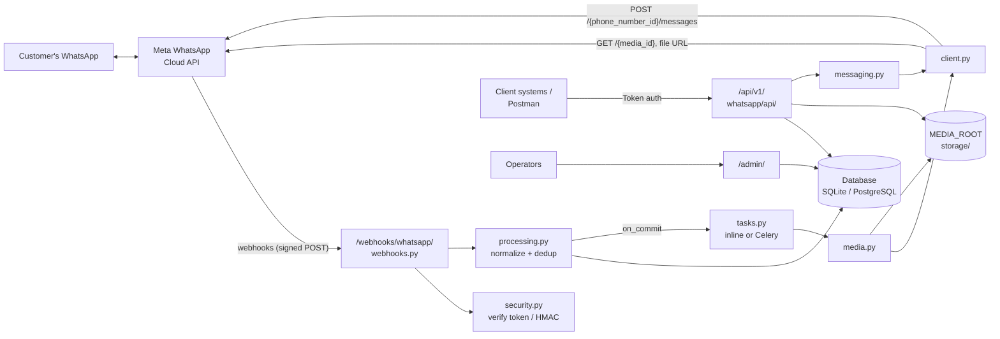
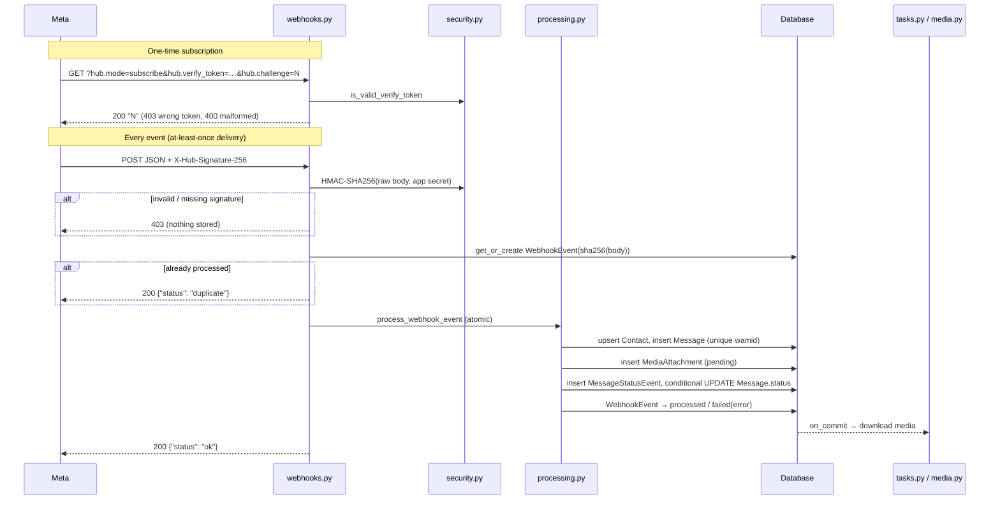
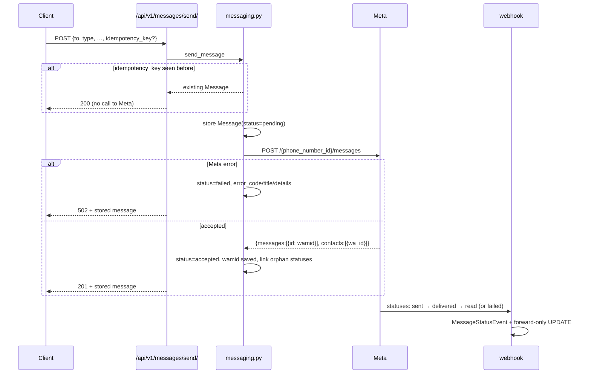

# USHIKA: Architecture

## 1. System overview



USHIKA is one Django project (`config/`) with one app (`whatsapp/`). Inside the app, modules are split by responsibility, so webhook handling, payload processing, media, outbound messaging, HTTP access to Meta and the REST layer can each change independently.

## 2. Component responsibilities

| Component | Responsibility | Talks to |
|---|---|---|
| `webhooks.py` | HTTP edge for Meta: handshake (GET) and event receipt (POST). Validates signature and JSON, records the delivery, triggers processing, always acknowledges valid deliveries. | `security`, `processing` |
| `security.py` | `is_valid_verify_token`, `is_valid_signature`, `compute_signature`. Constant-time comparisons. | settings |
| `processing.py` | Walks `entry[].changes[]`, stores inbound messages and contacts, creates attachments, records statuses, applies forward-only status changes, links orphan statuses. All writes are idempotent. | models, `tasks` |
| `tasks.py` | `schedule_media_download` (after commit) and `download_media_task` (Celery task, also callable inline). | `media` |
| `media.py` | Who may save which media (`save_refusal`: contact level for images and PDFs, superuser for the rest), media lookup, streaming download, size limit, SHA-256 and HTML checks, safe filenames, save through Django storage, outcome recording. Also `fetch_unsaved` (same checks, nothing stored) and `preview_mime_type` (what may be shown inline). | `client`, storage |
| `client.py` | `WhatsAppClient`: the only HTTP access to Meta. Bearer auth, timeouts, GET retries, Graph error parsing into `WhatsAppAPIError`. | Meta Graph API |
| `messaging.py` | Builds Cloud API message payloads, stores the message, sends, records the `wamid` or the error, handles idempotency keys. | `client`, `processing` |
| `api/` | DRF viewsets, serializers, filters, pagination, router (`/api/v1/`). Read APIs, send, preview, download, save, login check. | models, `messaging`, `media` |
| `admin.py` | Operator UI with contact levels, file previews and download links (served by `api/`), and the save-file and reprocess actions. | models, `media`, `processing` |
| `management/commands/` | `reprocess_webhooks`, `retry_media_downloads`. | `processing`, `media` |
| `config/celery.py` | Celery app (used only when `USE_CELERY=true`). | Redis |

## 3. Data model

```mermaid
erDiagram
    ContactLevel |o--o{ Contact : "decides saving"
    Contact ||--o{ Message : has
    Message ||--o{ MediaAttachment : has
    Message ||--o{ MessageStatusEvent : "status history"
    User ||--o{ Message : "sent_by (outbound)"

    ContactLevel {
        string name UK
        bool can_save_images
        bool can_save_pdfs
    }
    Contact {
        string wa_id UK "digits, international format"
        string profile_name
        fk level "nullable: no level saves nothing"
    }
    Message {
        string wa_message_id UK "wamid, nullable until accepted"
        string direction "inbound | outbound"
        string message_type "text, image, template, ..."
        string status "received | pending | accepted | sent | delivered | read | failed"
        text body "text / caption / summary"
        string context_wa_message_id "reply-to wamid"
        json payload "raw inbound message or outbound request"
        string error_code
        string idempotency_key UK
        datetime timestamp "WhatsApp time (inbound) / send time"
    }
    MediaAttachment {
        string media_id
        string media_type
        string mime_type
        string sha256 "as reported by WhatsApp"
        string filename "sanitised on save"
        file file "MEDIA_ROOT/whatsapp/YYYY/MM/media_id/name"
        string download_status "pending | downloaded | failed | skipped"
        int download_attempts
        text last_error
    }
    MessageStatusEvent {
        string wa_message_id "UK with status + timestamp"
        string status
        datetime timestamp
        string error_code
        json payload
    }
    WebhookEvent {
        string payload_sha256 UK
        json payload
        string status "received | processed | failed"
        int attempts
        text error
    }
```

**Uniqueness, the backbone of duplicate prevention**

| Constraint | Prevents |
|---|---|
| `WebhookEvent.payload_sha256` | Re-processing a byte-identical redelivery |
| `Message.wa_message_id` | The same message stored twice, even across differently batched deliveries |
| `(wa_message_id, status, timestamp)` on `MessageStatusEvent` | Duplicate status notifications |
| `Message.idempotency_key` | Double outbound sends on client retries |

`MessageStatusEvent.message` is nullable because a status can arrive for a message USHIKA doesn't know yet. This happens either for a message sent from outside USHIKA, or when the webhook beats the send response.

## 4. Webhook lifecycle



Stages:
1. **Handshake.** Meta proves the URL is yours by echoing `hub.challenge` when the verify token matches.
2. **Authenticity.** The HMAC is computed over the **raw body bytes** before parsing. Re-serialised JSON would not match.
3. **Audit and first-level dedup.** The body's SHA-256 is the `WebhookEvent` key. A byte-identical redelivery that already processed returns `duplicate`. A redelivery of a previously *failed* event is processed again.
4. **Processing.** Everything runs in one transaction. Only `field == "messages"` changes from `object == "whatsapp_business_account"` are handled; anything else is acknowledged and logged.
5. **Second-level dedup.** Per-message (`wamid`) and per-status unique keys, with `IntegrityError` caught inside savepoints so concurrent duplicate deliveries are safe.
6. **Side effects after commit.** Media downloads are scheduled with `transaction.on_commit(robust=True)`, so they only see committed rows, and a download failure can't break the webhook response.
7. **Acknowledgement.** Once the signature is valid the response is always 200, even if processing failed. A non-200 would make Meta resend the same payload for up to 7 days. The failure is kept on the `WebhookEvent` for `reprocess_webhooks`.

## 5. Media pipeline

```
webhook message (type=image|document|audio|video|sticker, {id, mime_type, sha256, filename?, caption?})
  └─ MediaAttachment(status = skipped)                  waits for POST /api/v1/attachments/{id}/save/
       │                                                 (status = pending + on_commit download_media_task instead, only when
       │                                                  WHATSAPP_DOWNLOAD_MEDIA is on, the type is in WHATSAPP_MEDIA_TYPES
       │                                                  and save_refusal allows it)
       └─ save_refusal(attachment, admin)                image → contact level can_save_images; application/pdf document →
          │                                              can_save_pdfs; anything else → superuser only. Refused: 403, no fetch
          └─ download_attachment
            1. GET /{API_VERSION}/{media_id}              → {url, mime_type, sha256, file_size}
            2. reject if file_size > MEDIA_MAX_BYTES      (not retryable)
            3. GET url (Bearer token, streamed, 64 KB chunks) into a temp file
                 - text/html response → "HTML instead of media" (retryable)
                 - running size > limit → abort (not retryable)
                 - empty body → retryable
            4. SHA-256 of the bytes vs Meta's value (hex or base64; unknown format → skipped with a warning)
            5. save via default storage: whatsapp/YYYY/MM/<media_id>/<sanitised filename or type_mediaid.ext>
            6. attachment: downloaded | failed(last_error), download_attempts += 1
```

**Retries.** On Celery, retryable failures retry three times with exponential backoff (30 s, 60 s, 120 s). Inline, and after Celery gives up, failures wait for the save endpoint, the admin action, or `retry_media_downloads`, all of which check `save_refusal` first. The command skips attachments at `WHATSAPP_MEDIA_MAX_ATTEMPTS` unless given explicit ids. Retry promptly: Meta's download URLs last about 5 minutes (each retry fetches a fresh one), and Meta does not keep inbound media indefinitely.

## 6. Outbound messaging and status tracking



**Status ranking:** `pending(0) < accepted(1) < sent(2) < delivered(3) < read(4) < failed(5)`. An update applies only if the new rank is higher, done as `UPDATE … WHERE status IN (lower ranks)`. Out-of-order or duplicate notifications therefore can't move a message backwards, even under concurrency. Unknown status strings are stored as events only.

**Orphan statuses.** Meta can send the `sent` webhook before the API response that carries the `wamid` has been saved. Such events are stored with `message=NULL`. `reconcile_orphan_statuses` attaches and applies them as soon as the send completes.

**No automatic send retries.** A retried POST can deliver twice, so sends are never retried by the client library. Callers retry safely with the same `idempotency_key`.

## 7. External integration (Meta Graph API)

| Call | Used for | Retry policy |
|---|---|---|
| `GET https://graph.facebook.com/{v}/{media_id}` | Media URL and metadata | 3× on 429/5xx (urllib3), plus task-level retries |
| `GET {media url}` | File bytes (Bearer token required) | same |
| `POST https://graph.facebook.com/{v}/{phone_number_id}/messages` | Send | never automatic |

Errors come back as `{"error": {"message", "code", "error_data": {"details"}, ...}}` and are mapped to `WhatsAppAPIError(code, title, details, retryable)`. Retryable means HTTP 429 or 5xx, Graph codes 1/2/4/17/80007/130429/131000/131016/133004, or a network error.

## 8. Database choices

- **SQLite** (default) needs no setup, which suits a single-developer POC and the test suite.
- **PostgreSQL** (`DB_ENGINE=postgres`, `requirements-prod.txt`) is for production: concurrent writers (web plus Celery workers), real row locking, backups, and JSONB for the raw payloads.
- The design relies on unique constraints and conditional updates rather than database-specific features, so both engines behave the same.

Indexes: `wa_message_id`, `wa_id`, `(contact, -timestamp)`, `direction`, `status`, `message_type`, `download_status`, `media_id`, and status-event `wa_message_id` and `status`.

## 9. Storage strategy

- Files are written through Django's **default storage** (`FileField` + `STORAGES`), rooted at `MEDIA_ROOT` (default `./storage`).
- Path layout: `whatsapp/<YYYY>/<MM>/<media_id>/<filename>`. Name collisions get a random suffix and never overwrite.
- **Nothing is publicly served.** There is no `MEDIA_URL` route; previews and downloads go through the authenticated API.
- Moving to S3, GCS or Azure is a configuration change (`django-storages` + `STORAGES["default"]`); `media.py` needs no code change. See [DECISIONS.md](DECISIONS.md#d3-local-filesystem-media-through-djangos-storage-api).

## 10. Background processing

| Mode | `USE_CELERY` | Where downloads run | Retries |
|---|---|---|---|
| Inline (default) | `false` | Inside the webhook request, right after commit | Manual (endpoint, admin, command) |
| Celery | `true` | Celery worker (`celery -A config worker`), Redis broker | Automatic backoff ×3, then manual |

Both modes go through `tasks.schedule_media_download`, so the call sites don't change. Inline mode makes large downloads delay the webhook acknowledgement, which is fine for the POC. Enable Celery for production volumes.

## 11. Error handling

| Failure | Behaviour | Recovery |
|---|---|---|
| Missing or invalid signature | 403, nothing stored, warning logged | — (sender must sign correctly) |
| Wrong verify token | 403 | Fix `WHATSAPP_VERIFY_TOKEN` or Meta config |
| Invalid JSON (signed) | 400 | — |
| Exception while processing | 200 to Meta; `WebhookEvent.status=failed`, `error` set; transaction rolled back | `manage.py reprocess_webhooks`, or Meta's redelivery |
| Duplicate delivery or message or status | Ignored; 200 (`duplicate` for identical bodies) | — |
| Media lookup or download error, hash mismatch, HTML page, empty file | `download_status=failed`, `last_error`, attempts counted | Celery auto-retry; `/save/`, admin action, `retry_media_downloads` |
| File over limit | `failed`, not retryable | Raise `WHATSAPP_MEDIA_MAX_BYTES` and retry by id |
| Outbound rejected by Meta | Message `failed` with `error_code/title/details`; API 502 | Fix the cause (24-hour window → template, allowed list, token); resend |
| Meta unreachable on send | Same as above (`failed`) | Resend with the same intent; use an idempotency key for safe client retries |
| Missing configuration (token, phone id) | Clear `WhatsAppAPIError` stored on the record | Fill `.env` and retry |

## 12. Configuration and logging

- `config/settings.py` reads everything from env vars. Meta settings sit in one `WHATSAPP` dict, read at call time.
- Loggers: `whatsapp.webhooks`, `whatsapp.processing`, `whatsapp.media`, `whatsapp.messaging` and `whatsapp.client` at `WHATSAPP_LOG_LEVEL`, plus `django` at INFO. Logs carry ids and error codes, never tokens, phone numbers or message text (see [SECURITY.md](SECURITY.md#logging-rules)).

## 13. Deployment topology (target)

```
            HTTPS (TLS at proxy / load balancer)
Meta ───────────────►┌──────────────────────┐
Clients ────────────►│ reverse proxy         │  X-Forwarded-Proto → SECURE_PROXY_SSL_HEADER
                     └─────────┬────────────┘
                               ▼
                     gunicorn config.wsgi (N workers)
                       │            │
                       ▼            ▼
                 PostgreSQL    Redis ◄── celery -A config worker
                       │
              persistent volume or object storage (MEDIA_ROOT / STORAGES)
```

Checklist in [SECURITY.md](SECURITY.md#deployment-security) and [TASKS.md](TASKS.md#phase-6-testing-and-deployment).
